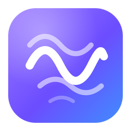
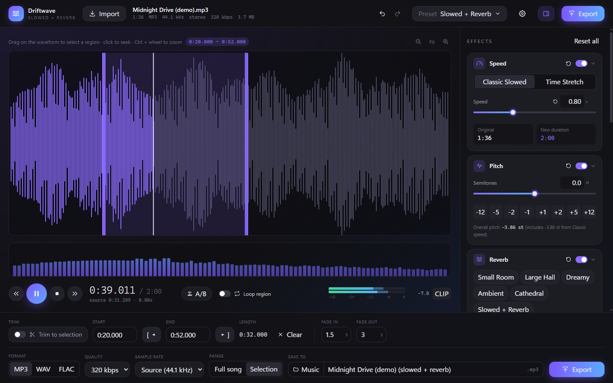

<p align="center">
  
</p>

<h1 align="center">Driftwave</h1>

<p align="center">
  A free Windows app for making <b>slowed + reverb</b>, sped up, nightcore, daycore and lo-fi edits of your own songs.<br/>
  Real-time preview, studio-quality time stretching, and exports that sound exactly like what you heard.
</p>

<p align="center">
  <a href="https://github.com/EmmanuelAwode/driftwave/releases/latest"><b>⬇ Download for Windows</b></a>
</p>



## Download and install

1. Go to the [latest release](https://github.com/EmmanuelAwode/driftwave/releases/latest) and download `Driftwave_x.y.z_x64-setup.exe`.
2. Run it. It installs for your user account only, so it doesn't need admin rights, and adds a Start menu shortcut.
3. If Windows SmartScreen says "Windows protected your PC", click **More info**, then **Run anyway**. The installer isn't code-signed yet, which is why the warning appears.

Requirements: Windows 10 or 11 (64-bit). FFmpeg is included, so there's nothing else to install.

## Features

- **Import**: drag and drop, or browse to an MP3, WAV, FLAC, M4A, OGG or AAC file. The app shows the file's duration, format, sample rate, bitrate and size. **Your original file is never modified.**
- **Speed** from 0.25× to 2.00×, in two modes:
  - *Classic Slowed*: pitch moves with speed, like a turntable. Changes are heard instantly.
  - *Time Stretch*: speed and pitch are independent. This uses Rubber Band, the same engine many DAWs use.
- **Pitch** from −12 to +12 semitones, with quick-step buttons.
- **Reverb** with wet/dry, room size, decay, pre-delay, damping, stereo width and a *low cut* that keeps bass out of the tail, so the mix stays clear instead of muddy. Includes six reverb presets.
- **Bass boost**, a 3-band **EQ**, **high-pass and low-pass filters**, **output gain**, **balance** and a **limiter** that stops clipping.
- **Song presets**: Slowed + Reverb, Super Slowed, Sped Up, Nightcore, Daycore, Bass Boosted, Dreamy, Lo-Fi, Underwater and Original. You can also save your own.
- **Waveform editing**: click to seek, drag to select, zoom, trim to the selection, loop it, add fades, or type exact start and end times.
- **A/B compare**: one click (or the **B** key) switches to the untouched original and back, without losing your settings.
- **Undo and redo** for every effect change (Ctrl+Z / Ctrl+Y).
- **Live meters**: a stereo level meter with a clip indicator, plus a spectrum analyser.
- **Export** to MP3 (up to 320 kbps or V0), WAV (16-bit, 24-bit or 32-bit float) or FLAC (16- or 24-bit). You can export the full song or just the selection, and the reverb tail is allowed to ring out at the end.
- **Remembers your last settings** and your export folder between launches.

## Keyboard shortcuts

| Key | Action |
| --- | --- |
| Space | Play / pause |
| ← / → | Seek 5 s (hold Shift for 1 s) |
| Home | Go to start |
| L | Loop the selection |
| B | A/B compare with the original |
| Esc | Clear the selection |
| Ctrl+Z / Ctrl+Y | Undo / redo |
| Ctrl+O | Import a song |
| Ctrl+E | Export |
| Ctrl+mouse wheel | Zoom the waveform |
| Double-click a slider | Reset it |

## Build from source

You need [Node.js](https://nodejs.org) 20+, [Rust](https://rustup.rs) (stable, MSVC toolchain), and the [Tauri prerequisites for Windows](https://tauri.app/start/prerequisites/).

```powershell
git clone https://github.com/EmmanuelAwode/driftwave.git
cd driftwave
npm install
pwsh scripts/fetch-ffmpeg.ps1   # downloads the bundled FFmpeg (GPL build with Rubber Band)
npm run tauri dev               # run in development
npm run tauri build             # build the installer -> src-tauri/target/release/bundle/nsis/
```

If the MSVC linker fails with `LNK1104` because your checkout path is very long, either clone to a shorter path (for example `C:\dev\driftwave`) or set a short `target-dir` in `src-tauri/.cargo/config.toml`.

### Releases

Publishing a GitHub release tagged `vX.Y.Z` triggers [`.github/workflows/release.yml`](.github/workflows/release.yml). That workflow builds the installer on Windows and attaches it to the release. Every push to `main` is also test-built by [`build.yml`](.github/workflows/build.yml).

## How it works

```
file ─FFmpeg decode─► float PCM ─► (Rubber Band render when needed, cached) ─► Web Audio effect chain ─► speakers
                                                                              └─► same chain, offline ─► FFmpeg encode ─► MP3 / WAV / FLAC
```

- The **same effect chain** (`src/audio/chain.ts`) runs in the live preview and in the export, at the same sample rate and with the same seeded reverb impulse response. That's why the export matches the preview.
- *Classic* speed uses live playback-rate changes, so it's instant. *Time Stretch* and pitch shifts are rendered in the background with Rubber Band (through FFmpeg) and cached. The old preview keeps playing until the new render is ready.
- Master volume only sets your listening level. Output gain is applied to the export.

| Path | Purpose |
| --- | --- |
| `src-tauri/src/ffmpeg.rs` | FFmpeg sidecar: probe, decode, Rubber Band, encode with progress |
| `src-tauri/src/lib.rs` | Tauri commands (import, PCM transfer, stretch render, export, settings) |
| `src/audio/` | Parameter model, effect chain, reverb IR synthesis, playback engine, offline render, presets |
| `src/state/store.ts` | App state and workflows (import, export, presets, undo/redo, persistence) |
| `src/components/` | UI |

User presets and settings are stored in `%APPDATA%\studio.driftwave.app\user-presets.json`.

## License

Driftwave is free software, licensed under the [GNU General Public License v3.0](LICENSE). The installer bundles an FFmpeg build that includes the GPL-licensed librubberband and libmp3lame. FFmpeg's license ships with the app as `FFMPEG-LICENSE.txt`.

Only use Driftwave on audio you have the right to edit and share.
